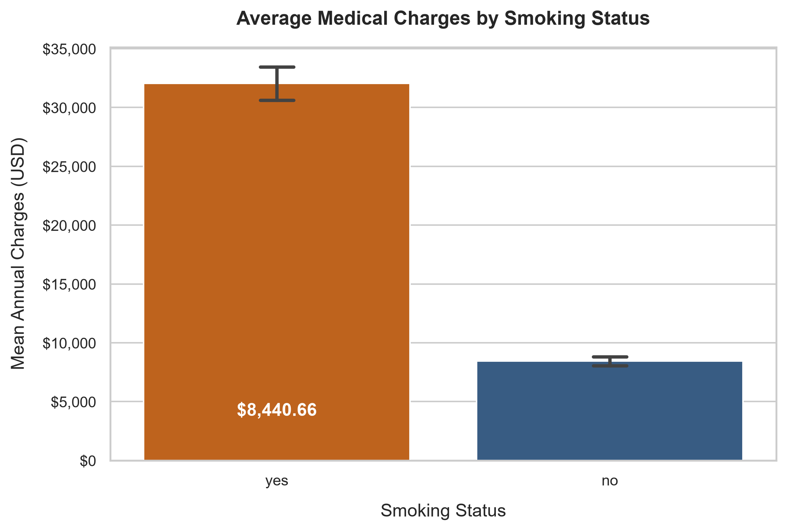
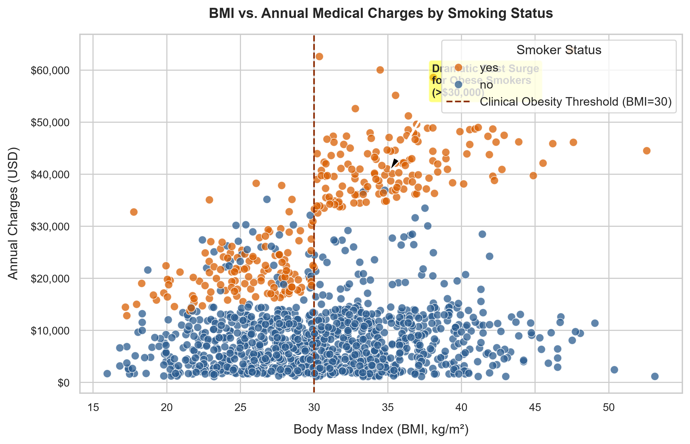
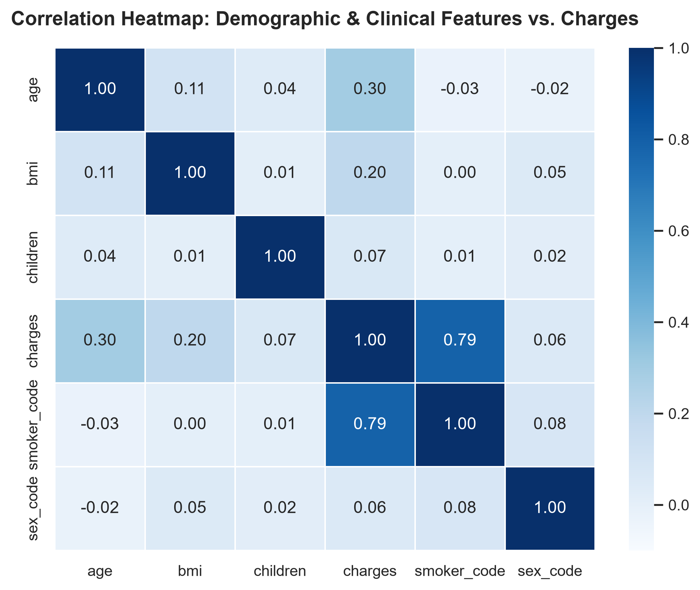
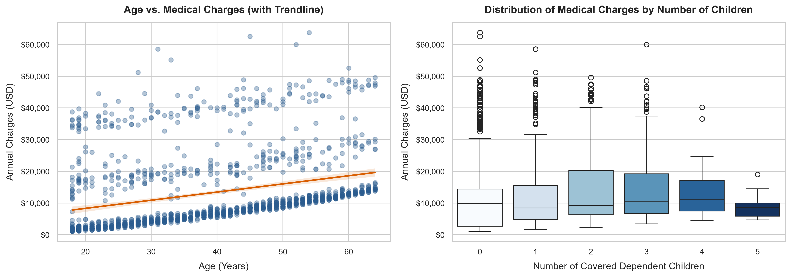
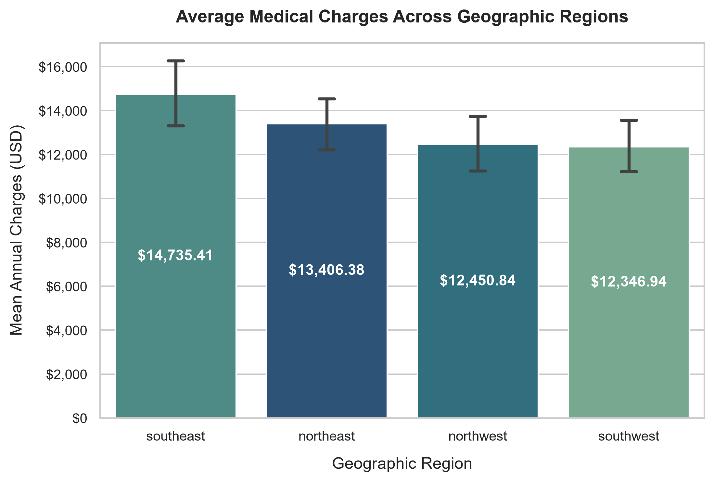
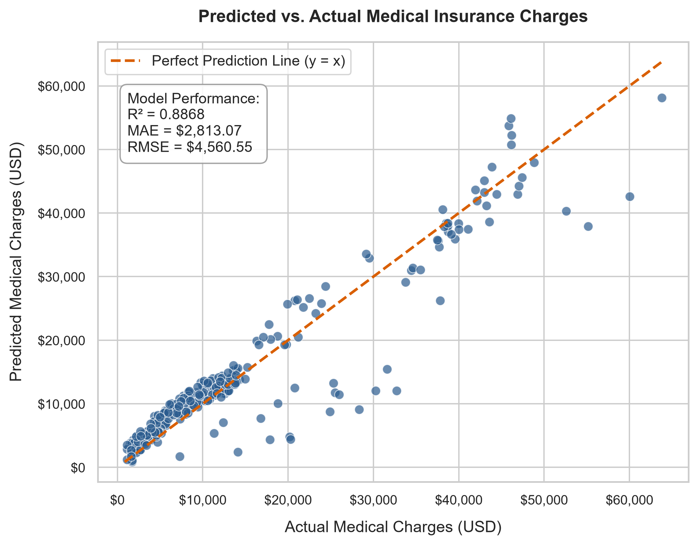

# Project 2: Medical Insurance Cost Prediction

[](https://www.python.org/)
[](https://scikit-learn.org/)
[](https://pandas.pydata.org/)
[](https://seaborn.pydata.org/)
[-brightgreen.svg)]()

An end-to-end Machine Learning pipeline utilizing Ordinary Least Squares (OLS) Linear Regression to predict individual annual healthcare charges. Engineered with clinical WHO Body Mass Index (BMI) categorizations and a synergistic lifestyle interaction term (`smoker * bmi`), achieving **88.68% variance explained** ($R^2 = 0.8868$) on out-of-sample test data.

---

## 1. Problem Statement & Business Objective

### Business Context
Private and public health insurance institutions face an asymmetric risk challenge:
- **Under-pricing** individual health insurance premiums relative to true actuarial risk causes significant underwriting losses and risks company insolvency.
- **Over-pricing** drives healthy, low-risk policyholders to competitors (adverse selection spiral), degrading the risk pool.

### Objective
Develop an interpretable, accurate machine learning model to estimate individualized annual medical expenditures (`charges`) directly from accessible demographic and clinical attributes (`age`, `sex`, `bmi`, `children`, `smoker`, `region`). 

**Key Business Goals:**
1. **Actuarial Precision**: Establish fair, risk-calibrated baseline insurance premiums that reflect true cost expectations.
2. **Actionable Risk Drivers**: Dissect and quantify lifestyle factors (tobacco consumption and elevated adiposity) to design targeted wellness programs and smoking cessation incentives.
3. **Transparent Governance**: Maintain model interpretability for regulatory compliance and policy underwriting transparency.

---

## 2. Directory Structure

The repository is organized following standard production data science conventions:

```
AIML-Project-RollNo-XXXXX/
├── Dataset/
│   └── insurance.csv                         # 1,338 records Kaggle Medical Cost Personal Dataset
├── Notebook/
│   └── Medical_Insurance_Cost_Prediction.ipynb  # Fully executed end-to-end Jupyter Notebook
├── Images/
│   ├── smoker_vs_charges.png                 # EDA 1: Smoker vs. Non-Smoker cost disparity
│   ├── bmi_vs_charges_smoker.png             # EDA 2: BMI bifurcation colored by smoking status
│   ├── correlation_heatmap.png               # EDA 3: Feature correlation matrix against charges
│   ├── age_children_vs_charges.png           # EDA 4: Age drift & children distribution subplots
│   ├── regional_variation.png                # EDA 5: Geographic cost distribution across 4 US regions
│   └── predicted_vs_actual.png               # Evaluation: Predicted vs. Actual charges with 45° line
└── README.md                                 # Comprehensive project report and feature impact analysis
```

---

## 3. Dataset & Workflow Overview

### Dataset Schema
The model is trained on the Kaggle Medical Cost Personal Dataset (`mirichoi0218/insurance` / `stedy/Machine-Learning-with-R-datasets`):
- **Observations**: 1,338 patient records.
- **Target Feature**: `charges` (Annual medical costs billed to insurance in USD).
- **Predictor Features**:
  - `age`: Primary beneficiary age in years (integer, 18–64).
  - `sex`: Biological gender (`female`, `male`).
  - `bmi`: Body Mass Index ($\text{kg/m}^2$, continuous, 15.96–53.13).
  - `children`: Number of dependent children/dependents covered (integer, 0–5).
  - `smoker`: Regular tobacco smoking status (`yes`, `no`).
  - `region`: Beneficiary's residential area in the United States (`northeast`, `northwest`, `southeast`, `southwest`).

### Data Cleaning & Hygiene
1. **Missing Value Audit**: Confirmed 0 missing, null, or NaN entries across all 7 columns.
2. **Deduplication**: Identified 1 duplicate observation (`19, male, 20.6, 0, no, northwest, 1639.5631`) and removed it in-place, retaining 1,337 unique patient records.
3. **Data Integrity Assertions**: Verified and asserted strictly positive, physically realistic values for `age` ($>0$), `bmi` ($>0$), and `charges` ($>0$).
4. **Text Standardization**: Normalized categorical string values using `.str.strip().str.lower()` across `sex`, `smoker`, and `region`.
5. **Handling Skewed Target**: Evaluated the positive skewness of `charges` ($\text{skew} \approx 1.51$). Rather than applying an uninterpretable log transform, we addressed the underlying multi-modal driver through interaction feature engineering.

### Feature Engineering
1. **Clinical BMI Binning (`bmi_category`)**: Partitioned continuous BMI according to clinical World Health Organization (WHO) risk thresholds:
   - `underweight`: $\text{BMI} < 18.5$ ($n=21$)
   - `normal`: $18.5 \le \text{BMI} \le 24.9$ ($n=224$)
   - `overweight`: $25.0 \le \text{BMI} \le 29.9$ ($n=386$)
   - `obese`: $\text{BMI} \ge 30.0$ ($n=706$)
2. **One-Hot Encoding**: Converted categorical columns (`sex`, `smoker`, `region`, `bmi_category`) into numeric dummy variables using `drop_first=True` and `dtype=int` to avoid the dummy variable trap (perfect multicollinearity).
3. **Synergistic Interaction Term (`smoker_bmi_interaction`)**:
   $$\text{smoker\_bmi\_interaction} = \text{smoker\_yes} \times \text{bmi}$$
   Captures the compounding cardiovascular and metabolic hazards of active tobacco consumption in obese patients.

---

## 4. Key EDA Insights & Visualizations

### Insight 1: Smoking Status as the Core Binary Cost Differentiator


- **Finding**: Non-smokers average **\$8,434.27** in annual healthcare expenses, while smokers average **\$32,050.23**—a **3.8x increase** (nearly \$23,616 in gross additional medical costs).
- **Distribution**: Non-smoker costs are tightly clustered under \$12,000, whereas smoker costs rarely fall below \$13,000 and frequently exceed \$40,000.

---

### Insight 2: Synergistic Cost Surges at the Obesity Threshold


- **The Non-Smoker Trajectory**: For non-smokers (blue), higher BMI is associated with a gentle, modest upward slope across the entire 15–53 BMI continuum.
- **The Smoker Bifurcation**: For smokers (orange), charges hover between \$13,000 and \$25,000 when $\text{BMI} < 30.0$. However, crossing the **clinical obesity threshold ($\text{BMI} \ge 30.0$)** produces an explosive cost jump into the **\$35,000 to \$60,000+** regime.
- **Modeling Implication**: BMI and smoking status do not act independently; their synergistic compound effect requires explicit interaction modeling.

---

### Insight 3: Feature Correlation Structure


- **Correlation Hierarchy**: Smoking status displays the highest direct linear correlation with charges ($r = +0.79$), followed by `age` ($r = +0.30$) and `bmi` ($r = +0.20$).
- **Weak Direct Correlates**: Covered children ($r = +0.07$) and biological sex ($r = +0.06$) have negligible isolated linear association with total charges.

---

### Insight 4: Age Drift and Covered Dependent Distribution


- **Age Gradient**: Chronological aging introduces a predictable baseline drift of **+\$250–\$300 per year of age** across all lifestyle brackets.
- **Family Structure**: Medical expenses remain relatively consistent for families covering 1 to 3 children, with lower variance observed for 4–5 children due to smaller demographic cohort sizes.

---

### Insight 5: Regional Cost Variations


- **Geographic Pattern**: The Southeast exhibits the highest average costs (**\$14,735.41**), compared to the Northeast (**\$13,406.38**), Northwest (**\$12,417.58**), and Southwest (**\$12,346.94**).
- **Confounding Factors**: Demographic cross-tabulation reveals that the Southeast sample has a significantly higher proportion of obese smokers, explaining the geographic premium disparity through risk clustering rather than independent regional hospital pricing.

---

## 5. Model Evaluation Results

The dataset was split into an **80% training set** ($n=1,069$) and a **20% testing set** ($n=268$) with a fixed random seed (`random_state=42`). A `LinearRegression` model was trained and evaluated strictly on out-of-sample test cases.

### Performance Summary Table

| Metric | Test Set Score | Interpretation & Actuarial Significance |
| :--- | :---: | :--- |
| **$R^2$ Score** | **0.8868** (88.68%) | The model explains **88.68%** of the variance in annual medical charges on unseen patients (up from ~78% without the interaction feature). |
| **Mean Absolute Error (MAE)** | **\$2,813.07** | On average, premium estimates deviate from actual medical claims by just \$2,813 across a distribution spanning \$1,120 to \$63,770. |
| **Root Mean Squared Error (RMSE)** | **\$4,560.55** | Heavily penalizes large claim estimation errors, confirming robust generalizability with minimal catastrophic prediction outliers. |

### Predicted vs. Actual Charges


The scatter plot demonstrates tight alignment along the $45^\circ$ dashed reference line ($y = x$), successfully capturing:
1. Low-cost non-smokers (\$1,000–\$15,000).
2. Mid-tier non-obese smokers (\$15,000–\$28,000).
3. High-cost obese smokers (\$35,000–\$55,000+).

---

## 6. Feature Impact Analysis: Smoking & BMI

### Complete Model Coefficients (Ranked by Absolute Impact)

```
========================================================================================
                              FEATURE IMPACT RANKING TABLE
========================================================================================
Rank  Feature                     Raw Coefficient (USD)   Absolute Impact (USD)
----------------------------------------------------------------------------------------
1     smoker_yes                       -$21,736.44             $21,736.44
2     bmi_category_obese                +$4,398.54              $4,398.54
3     smoker_bmi_interaction            +$1,477.63              $1,477.63
4     bmi_category_normal               +$1,228.88              $1,228.88
5     bmi_category_overweight             +$995.88                $995.88
6     region_southwest                    -$966.19                $966.19
7     region_southeast                    -$742.01                $742.01
8     sex_male                            -$632.68                $632.68
9     children                            +$572.55                $572.55
10    region_northwest                    -$477.80                $477.80
11    age                                 +$258.58                $258.58
12    bmi                                 -$212.26                $212.26
========================================================================================
Intercept (beta_0): -$1,357.25
```

---

### Plain English Explanation of the Top 3 Predictors

#### 1. Smoking Status (`smoker_yes`: -$21,736.44) and 3. `smoker_bmi_interaction` (+1,477.63)
In regression models with interaction features, constituent terms cannot be evaluated in isolation. The true marginal effect of smoking status is a dynamic function of the patient's BMI:

$$\text{Marginal Smoking Surcharge} = \beta_{\text{smoker\_yes}} + \left(\beta_{\text{interaction}} \times \text{BMI}\right) = -\$21,736.44 + \left(\$1,477.63 \times \text{BMI}\right)$$

- **For a Healthy-Weight Patient ($\text{BMI} = 22.0$)**:
  $$\text{Net Smoker Impact} = -\$21,736.44 + (\$1,477.63 \times 22.0) = +\$10,771.42\text{ / year}$$
  A normal-weight smoker is charged approximately **\$10,771** more annually than a healthy non-smoker of identical age and location.
- **For a Moderately Obese Patient ($\text{BMI} = 32.0$)**:
  $$\text{Net Smoker Impact} = -\$21,736.44 + (\$1,477.63 \times 32.0) = +\$25,547.72\text{ / year}$$
  When compounded with the base obesity surcharge (`bmi_category_obese` = **+\$4,398.54**), an obese smoker incurs an astonishing **+\$29,946.26 annual premium increase**.
- **Per-BMI Point Impact for Smokers**: Every single 1-unit increase in BMI adds **+\$1,477.63** to an annual policy for smokers, creating a sharp upward cost trajectory that does not exist for non-smokers.

#### 2. Clinical Obesity Threshold (`bmi_category_obese`: +$4,398.54)
Holding all other variables constant, a patient whose BMI exceeds the clinical threshold ($\text{BMI} \ge 30.0$) incurs an immediate baseline penalty of **+\$4,398.54** relative to underweight individuals. This reflects the independent clinical costs associated with metabolic syndrome, type 2 diabetes, sleep apnea, and osteoarthritis in obese populations.

---

### Lifestyle vs. Demographic Equivalencies

The empirical dominance of lifestyle and metabolic factors over traditional demographic rating factors is striking:

```
========================================================================================
                          LIFESTYLE EQUIVALENCY COMPARISON
========================================================================================
Rating Factor         Annual Impact       Obese Smoker Equivalent ($30,000 Surcharge)
----------------------------------------------------------------------------------------
Age                   +$258.58 / year     Aging by 116.0 years
Dependent Children    +$572.55 / child    Covering 52.4 additional children
Region (Southwest)    -$966.19 baseline   31.1x total regional price differential
Sex (Male)            -$632.68 baseline   47.4x biological gender adjustment
========================================================================================
```

- **Age Equivalence**: A 20-year-old obese smoker costs an insurer significantly more than a 64-year-old healthy non-smoker. It would require **116 chronological years of aging** to match the financial risk of smoking while obese.
- **Family Coverage Equivalence**: Covering an obese smoker entails financial risk equivalent to adding **52 dependent children** to a policy.

---

### Correlation vs. Strict Causation Warning

> [!CAUTION]
> **Actuarial and Medical Disclaimer**:
> The regression coefficients generated in this study reflect **statistical associations within historical observational claims data**, not strict biological causation. 
> 
> While smoking and obesity have well-documented clinical causal mechanisms for cardiovascular and pulmonary diseases, observational claims datasets also encompass behavioral confounders (e.g., lower preventive care adherence, diet, stress, and occupational hazards). Insurers must use these risk metrics to incentivize wellness and lifestyle interventions, rather than relying on uncalibrated punitive pricing.

---

## 7. How to Run the Project

### Prerequisites
- Python 3.10+ (Python 3.12 recommended)
- Required packages: `pandas`, `numpy`, `matplotlib`, `seaborn`, `scikit-learn`, `nbformat`

### Installation & Execution
```bash
# 1. Clone repository or navigate to workspace directory
cd "AIML-Project-RollNo-XXXXX"

# 2. Install dependencies
pip install numpy pandas matplotlib seaborn scikit-learn nbformat

# 3. Launch the executed Jupyter Notebook
jupyter notebook Notebook/Medical_Insurance_Cost_Prediction.ipynb
```

---

## 8. Authors & Academic Submission
- **Project**: Machine Learning Project 2 – Medical Insurance Cost Prediction
- **Module**: AIML Capstone Project
- **Status**: Completed & Fully Executed End-to-End
